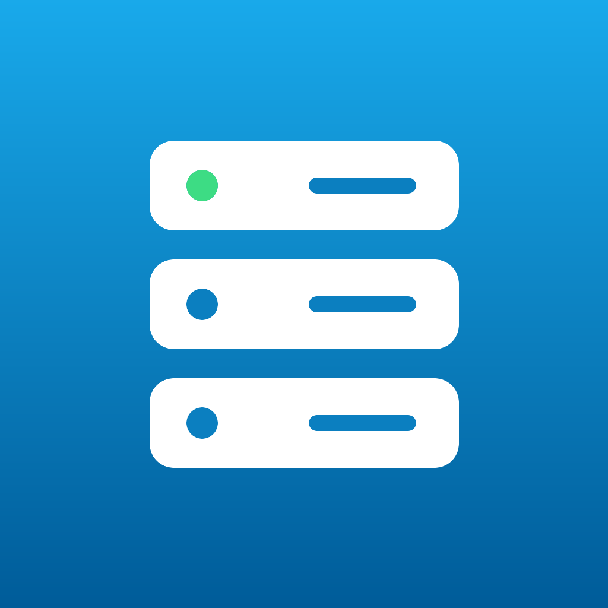
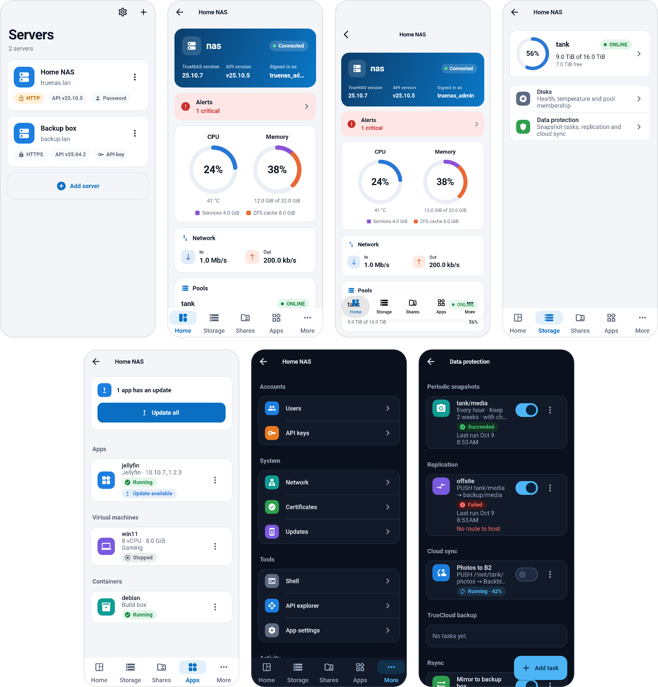

# TrueNAS Mobile

Manage your TrueNAS servers from your phone. TrueNAS Mobile is a Flutter app
for Android and iOS that talks to the official TrueNAS middleware API
(JSON-RPC 2.0 over WebSocket) and supports TrueNAS **25.04 and newer**.



## Features

- **Servers:** save as many TrueNAS servers as you like. Sign in with an API
  key (recommended) or a username, password and 2FA code. Self-signed
  certificates are pinned on first use.
- **Dashboard:** live CPU, memory (with ARC), network and pool health, plus
  system info and an alert summary. Alerts can be dismissed and restored, and new ones can be sent to the
  phone as notifications (checked in the background, off by default).
- **Jobs:** running and recent jobs with progress, and abort. Scrubs,
  replications, app and system updates, cloud and rsync tasks also show their
  progress in a card over the server screen and on the lock screen (a Live
  Activity on iOS, a progress notification on Android, a live update on
  Android 16). There is no push server, so the lock screen only moves while
  the app is running or kept alive by the phone; when it stops hearing from the
  server it says so. Settings > General > Live job progress turns it off.
- **Storage:** pools with layout, scrub start, pause and stop; datasets and
  zvols (create, delete); snapshots (create, roll back, delete); disks with
  temperatures.
- **Data protection:** periodic snapshot, replication, cloud sync, TrueCloud
  backup and rsync tasks with their last result. Run, stop, enable or
  disable any of them, and add, edit or delete every kind.
- **Shares:** SMB and NFS shares (create, edit, delete), services (start,
  stop, start on boot), and read-only views of iSCSI and NVMe-oF.
- **Apps and VMs:** Docker apps (start, stop, redeploy, upgrade, delete, or
  update all that have a newer version, after listing them), virtual machines
  and containers (start, stop, restart), each with a shell.
- **System:** users and groups, API keys, network and certificates
  (read-only), updates and boot environments, reboot and shut down.
- **Shell:** a terminal on the server, with Esc, Tab, Ctrl+C and arrow keys.
- **API explorer:** every method the server exposes, with its documentation
  and a generated form to call it, so anything without its own screen is
  still reachable.
- **Tablets:** a navigation rail and a two-column dashboard on wide screens.
- **App updates:** looks for a newer release on GitHub when the app opens
  (switch it off in Settings), shows the release notes, and lets you skip a
  version. On Android it downloads the APK and opens the installer; on iOS it
  opens the release page.
- **Settings:** theme, haptics, shell font size and keys, trusted
  certificates, and a link to the app's language page.
- **Languages:** English and Hungarian. The language is chosen in the phone's
  own settings for the app (iOS Settings, and Android 13 or newer); Android 12
  and older pick it inside the app.

## Supported TrueNAS versions

| TrueNAS | API | Status |
|---|---|---|
| 25.04 (Fangtooth) | `v25.04.x` | Supported |
| 25.10 (Goldeye) | `v25.10.x` | Supported |
| 26.0 and later | `v26.0.0`, `v27.0.0`, ... | Supported |

The app reads `GET /api/versions` and connects to the newest API version it
understands, then discovers the available methods with `core.get_methods`, so
features appear or hide based on what your server offers. The legacy REST API
(removed in TrueNAS 26) is never used.

## Install

Download the latest APK or IPA from the
[Releases](https://github.com/ADRIAN3003/truenas-mobile/releases) page.

- **Android:** install the APK for your CPU, which is `arm64-v8a` on nearly
  every phone made in the last decade (for example
  `truenas-mobile-v0.1.3-arm64-v8a-release.apk`). You may need to allow
  installs from unknown sources. After that the app can update itself: it
  downloads the new APK from the Releases page and opens the installer.
- **iOS:** the IPA is unsigned. Sideload it with a tool such as
  [AltStore](https://altstore.io/) or [Sideloadly](https://sideloadly.io/),
  which sign it with your Apple ID. The IPA holds a second bundle, the
  `JobActivityWidget` extension, for the lock screen progress; the signing tool
  must sign it too (AltStore and Sideloadly do).

## Build from source

Requirements: [Flutter](https://docs.flutter.dev/get-started/install) (stable
channel), Android SDK for Android, Xcode on macOS for iOS.

```sh
git clone https://github.com/ADRIAN3003/truenas-mobile.git
cd truenas-mobile
flutter pub get
flutter run                      # on a connected device or emulator
flutter test                     # unit and widget tests
flutter build apk --release      # Android
flutter build ipa --no-codesign  # iOS (macOS only)
```

## Releases

Pushing a tag like `v0.1.0` runs the release workflow, which builds the APKs,
an AAB and an IPA and attaches them to a GitHub Release.

To sign Android releases, add these repository secrets:

| Secret | Value |
|---|---|
| `ANDROID_KEYSTORE_BASE64` | `base64 < upload-keystore.jks \| tr -d '\n'` (works on macOS and Linux) |
| `ANDROID_KEY_ALIAS` | key alias |
| `ANDROID_KEY_PASSWORD` | key password |
| `ANDROID_STORE_PASSWORD` | keystore password |

Without them, every release APK is signed with a new throw-away debug key, and
Android refuses to install one release over another ("app not installed" or
"unable to update"). [`tools/make-android-keystore.sh`](tools/make-android-keystore.sh)
makes the key and prints the four values. Keep the key file: with a lost key,
everyone has to uninstall the app before updating. Moving from debug-signed
builds to a signed one also needs one uninstall, which removes the saved
servers from the phone.

## Translations

The app ships in English and Hungarian, with English as the base. All UI
text lives in ARB files under [`lib/l10n/`](lib/l10n/), and `app_en.arb` is
the template. To add a language:

1. Copy `lib/l10n/app_en.arb` to `app_<locale>.arb` (for example
   `app_de.arb`), set `"@@locale"` and translate the values.
2. Add the locale to `CFBundleLocalizations` in `ios/Runner/Info.plist` and
   to `android/app/src/main/res/xml/locales_config.xml`, which is how the
   phone's per-app language page learns about it.
3. Run `flutter gen-l10n` (it also runs automatically on build).

## Screenshots

The screenshots in [`docs/screenshots/`](docs/screenshots/) are rendered from
the test suite's fake server. To regenerate them:

```sh
SCREENSHOTS=1 flutter test test/screenshots --update-goldens
```

The same run also lays them out in `overview.png`, the single image at the
top of this README, so it scales to the screen on phones.

## AI usage

Most of this app's code, tests and documentation were written by an AI
assistant, [Claude](https://claude.ai) (Claude Code, through Claude
Projects), working under the direction of the maintainer. The maintainer
chose what to build, reviewed the changes, and tests each release on real
devices against a real TrueNAS server. Automated checks (formatting,
analysis and tests) run on every pull request.

AI-written code can still contain mistakes. Please
[open an issue](../../issues) if you find one, and see the disclaimer below
before pointing the app at a server that holds data you care about.

## Contributing

Issues and pull requests are welcome. See [CONTRIBUTING.md](CONTRIBUTING.md)
for setup, the checks to run before opening a PR, and the project conventions.

## License

[MIT](LICENSE)

## Disclaimer

This is an independent, community project. It is not affiliated with or
endorsed by iXsystems, Inc. TrueNAS is a registered trademark of iXsystems, Inc.
